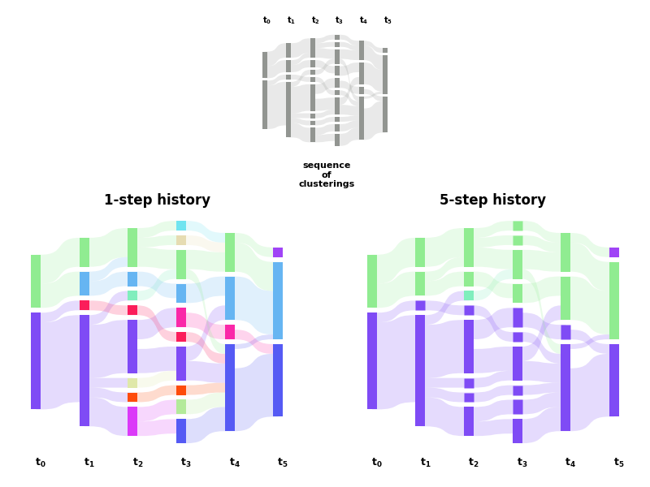

MajorTrack
==========

.. image:: https://zenodo.org/badge/184266412.svg
   :target: https://zenodo.org/badge/latestdoi/184266412

Dynamic community detection method tracking persistent but transiently
discontinuous communities in time window graphs.

.. inclusion-p1

Synthetic example
=================

Effect of the history parameter
-------------------------------

.. exclusion-p1

The script generating this figure can be found `here`_.

.. _here: examples/history.py

.. inclusion-p2

Installation
=============

You can get the latest version with

.. code-block:: console

    pip install --upgrade git+https://github.com/j-i-l/majortrack.git

Basic usage
===========

MajorTrack takes a time series of groupings (e.g. the communities detected in
each snapshot of a temporal network) and links the groups into dynamic
clusters (DCs):

.. code-block:: python

    from majortrack import MajorTrack

    # clusterings: list (one entry per time point) of lists of sets of members
    # individuals: list (one entry per time point) of the sets of present members
    mt = MajorTrack(clusterings=clusterings, individuals=individuals, history=5)
    mt.get_group_matchup('fraction')
    mt.get_dcs()                     # absorption=True by default
    mt.get_community_membership()
    mt.get_individual_membership()   # DC label of every member at every time point
    mt.get_community_events()        # births, deaths, splits and merges

Every time point must contain at least one group; otherwise a ``ValueError``
is raised.

Absorption
----------

Groups enclosed by the identity flow of a DC (in the intersection of the
mapper tree of the target group and the tracer tree of its source set) are
transient decompositions of that DC. By default they are absorbed into it.
Use ``mt.get_dcs(absorption=False)`` to keep them as separate DCs, e.g. to
study transient sub-groups explicitly.

Choosing the window and the history
===================================

The results depend mainly on how snapshots are aggregated into time windows
and on the history parameter. The tool ``tuning/majortrack_tune.py`` selects
both without ground truth for a raw interaction dataset (CSV edge list, NumPy
array or R list of matrices):

.. code-block:: console

    python tuning/majortrack_tune.py scan   --input data.csv --out results/
    python tuning/majortrack_tune.py select --out results/
    python tuning/majortrack_tune.py run    --input data.csv --out results/

The window maximising the total consistency of the DCs is selected (and
cross-checked with the window minimising the connections between DCs per
transition), and the history is the value at which the total consistency
saturates. See ``tuning/README.md`` for details.

Synthetic benchmark
===================

``synthetic_simulations/`` contains a generator (R) of temporal networks with
a planted dynamic community structure (merges, splits and drifts of elements),
nine benchmark scenarios, and the Python scripts that evaluate MajorTrack on
them (history, aggregation windows, absorption, and validation of the
parameter selection). See ``synthetic_simulations/README.md``.

Changes
=======

- ``get_dcs(absorption=True)``: absorption of transient groups can be
  switched off; the default reproduces the previous behaviour.
- ``MajorTrack`` raises an informative ``ValueError`` for time points without
  groups.
- Raw docstring in ``get_alluvialdiagram`` (no ``SyntaxWarning`` on recent
  Python versions).
- New: synthetic benchmark (``synthetic_simulations/``) and parameter
  selection tool (``tuning/``).

Citation
========

Liechti, J. I. and Bonhoeffer, S. A time resolved clustering method revealing
longterm structures and their short-term internal dynamics.
`arXiv:1912.04261 <https://arxiv.org/abs/1912.04261>`_ (2019).

.. exclusion-p2

Documentation
==============

http://majortrack.rtfd.io/
